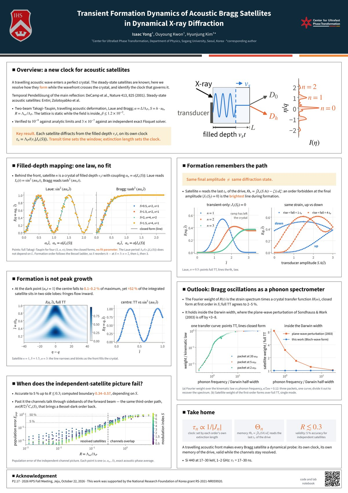
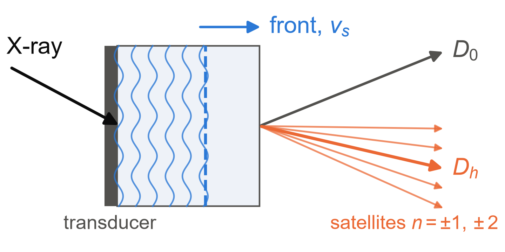
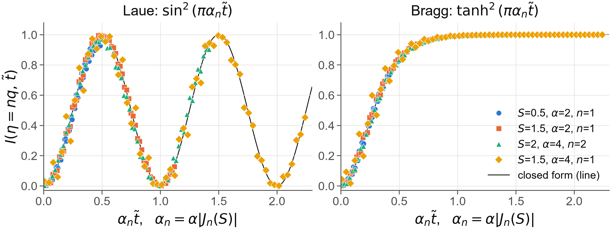
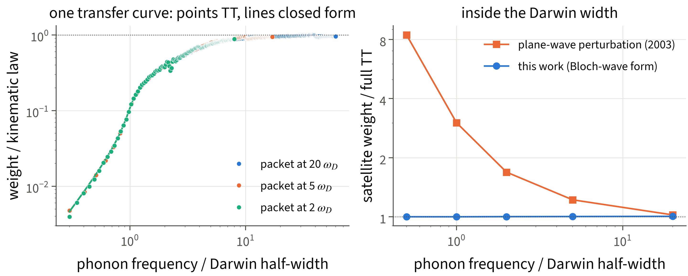

# TraTT — transient formation of acoustic Bragg satellites

A travelling acoustic wave enters a perfect crystal. Its steady-state X-ray satellites are textbook
material. This repository resolves how the satellites **form** while the wavefront crosses the
crystal, using two-beam Takagi–Taupin theory, and records every step in a lab notebook.

**KPS 2026 Fall Meeting, poster P2.17** (Jeju, 22 October 2026). Isaac Yong, Ouyoung Kwon,
Hyunjung Kim — Center for Ultrafast Phase Transformation, Sogang University.

<p align="center">
  
</p>

## Results



| | result | notebook |
|---|---|---|
| **Clock** | Satellite *n* diffracts from the filled depth *v<sub>s</sub>t* with coupling α\|J<sub>n</sub>(S)\|. Laue reads sin²(πα<sub>n</sub>t̃) and Bragg reads tanh²(πα<sub>n</sub>t̃), with no fit parameter. Each order has its own clock, τ<sub>n</sub> = Λ<sub>P</sub>/(v<sub>s</sub>\|J<sub>n</sub>(S)\|). | Entries 1, 9, 24 |
| **Memory** | A satellite reads the last transit time of the drive, Θ<sub>n</sub> = ∫J<sub>n</sub>(S A(t−ζ)) dζ. An order that is forbidden at the final amplitude can be the brightest line during formation. | Entries 28, 30 |
| **Validity** | The independent-satellite picture is accurate to 5 % for R = Λ<sub>ac</sub>/Λ<sub>P</sub> ≲ 0.3. Past that, the channels couple through sidebands of the forward beam. | Entries 52–54 |
| **Outlook** | The Fourier weight of R(t) is the strain spectrum times a crystal transfer function H(ω), in closed form at first order. It holds inside the Darwin width, where the plane-wave perturbation of Sondhauss & Wark (2003) is off by ×3–8. | Entries 59, 64 |




## Setup

```
uv sync --extra dev
uv run pytest -q                        # 54 tests: analytic limits, Floquet cross-check, formation law
uv run python explore/make_poster_figs.py   # poster figures -> figures/poster/
uv run python poster/build.py               # poster/poster.md -> poster/out/poster.pdf
```

## Layout

```
src/tratt/      solver package
  core.py         Laue IVP and Bragg Riccati (RK4, vectorised over eta and time; Bragg absorption kappa)
  drive.py        travelling acoustic drive phi(zeta; t): front, rise, amplitude profile
  floquet.py      exact Floquet solver for a uniformly filled crystal (independent cross-check)
  observe.py      channel windows, formation time, peak width
  cube.py         rocking curve over time (I(eta, t) cubes)
  sweep.py        parameter grids
tests/          analytic ground truth as asserts
notes/          lab_notebook.md: every result, with its script and its caveats (Entries 0-64)
explore/nb/     one script per notebook entry (eNN_*.py), with small cached results
explore/        figure scripts; make_poster_figs.py draws the poster figures
poster/         poster.md (the only source of poster text), build.py (layout + checks), fonts
figures/        figures referenced by the notebook and the poster
DESIGN.md       physics conventions, analytic limits, assumptions
```

Every item on the poster carries a tag pointing to a notebook entry. `poster/build.py` refuses to
pass if a tag points to an entry that does not exist.

## Notebooks

`explore/*.ipynb` are tracked with `nbstripout` as a git filter (`.gitattributes`). Outputs are
removed at commit time and stay in your working copy. If you move the repository or rebuild the
venv, re-register the filter:

```
uv run nbstripout --install --attributes .gitattributes
```

## Acknowledgement

This work was supported by the National Research Foundation of Korea, grant RS-2021-NR059920.
